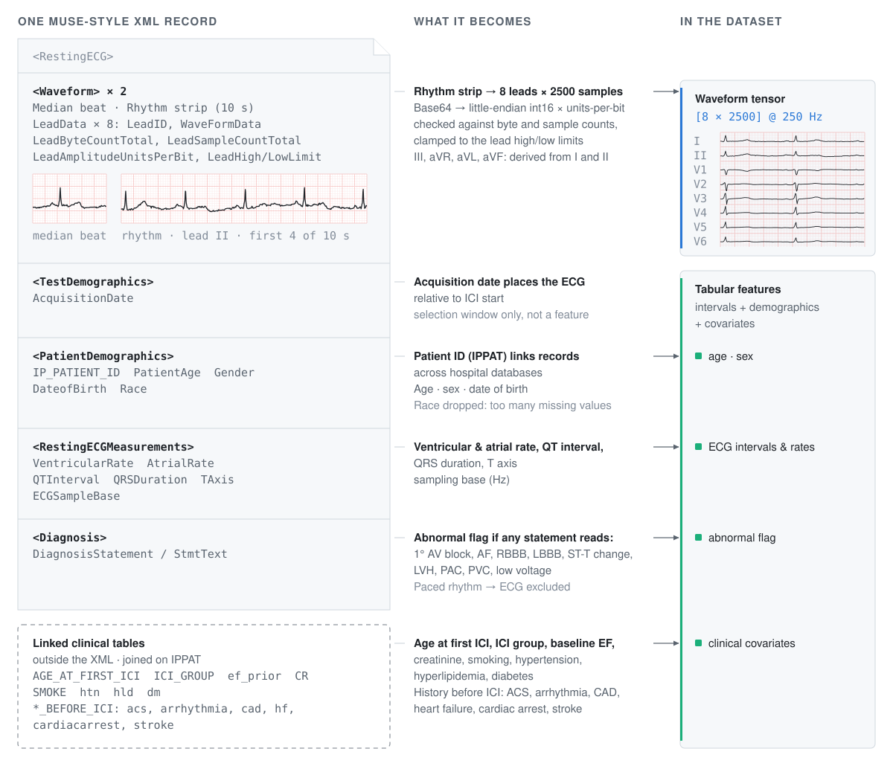
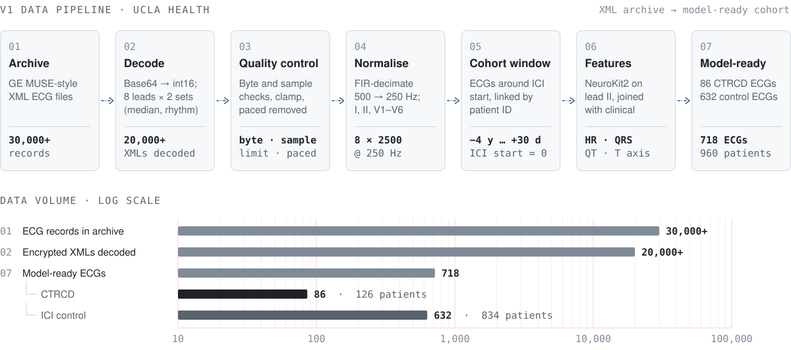
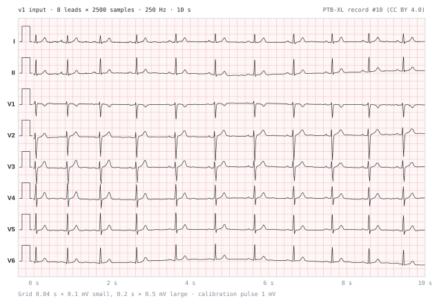
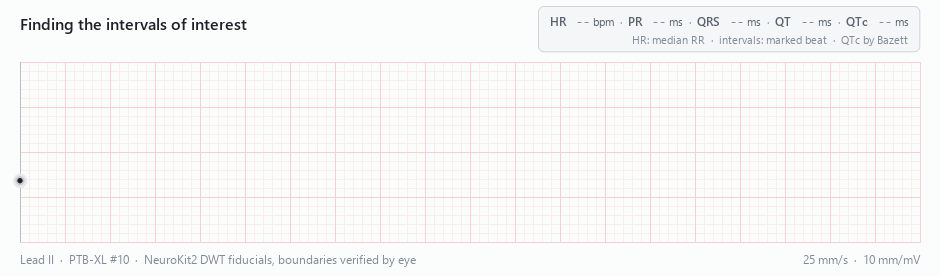
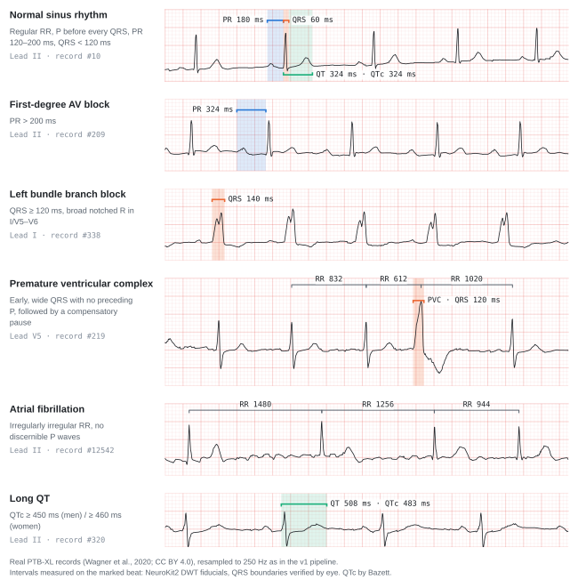
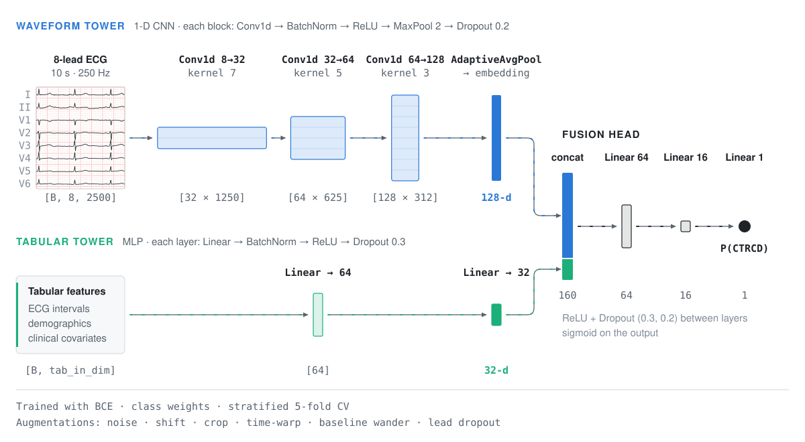
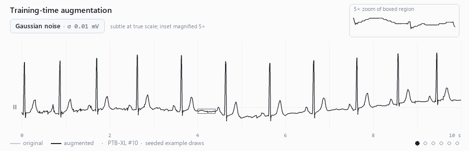
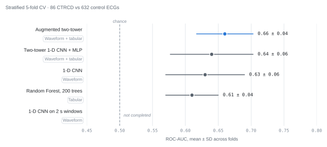

<picture>
  <source media="(prefers-color-scheme: dark)" srcset="docs/assets/hero-dark.svg">
  
</picture>

  
  
  
  

**Can a routine 12-lead ECG, recorded before a cancer patient starts immunotherapy, flag who will go on to develop heart damage?**

AI-ECG is a deep-learning research project on raw ECG waveforms. Version 1 was run at UCLA Health on cancer patients treated with immune checkpoint inhibitors (ICIs). It predicted cancer-therapy-related cardiac dysfunction (CTRCD) from 10-second, 8-lead ECG waveforms combined with clinical covariates. The UCLA data is protected health information and stays at UCLA. This repository holds the study code and slide deck, and the project's next phase: **replicating the same experimental design on open and credentialed public datasets** (PTB-XL, MIMIC-IV-ECG, MIMIC-IV-ECHO).

<table>
  <tr>
    <td align="center"><b>30,000+</b> patient ECG records in the source archive</td>
    <td align="center"><b>20,000+</b> encrypted 12-lead XML files decoded on Linux</td>
    <td align="center"><b>960 patients · 718 ECGs</b> final ICI cohort (126 CTRCD · 834 controls)</td>
    <td align="center"><b>8 × 2500</b> leads × samples per input (10 s at 250 Hz)</td>
    <td align="center"><b>0.66 ROC-AUC</b> best pilot model, augmented two-tower</td>
  </tr>
</table>

> [!NOTE]
> The full v1 slide deck is in [`archive/ctrcd-ici-study/AI_ECG_Presentation.pdf`](archive/ctrcd-ici-study/AI_ECG_Presentation.pdf). Every waveform shown in this README is a real, openly licensed [PTB-XL](https://physionet.org/content/ptb-xl/1.0.3/) record processed exactly as the v1 pipeline processed UCLA data. No patient data from the study appears here.

## Contents

1. [Study design](#1-study-design)
2. [The data and the pipeline](#2-the-data-and-the-pipeline)
3. [What the model sees](#3-what-the-model-sees)
4. [Intervals of interest and what they signal](#4-intervals-of-interest-and-what-they-signal)
5. [Models](#5-models)
6. [Pilot results](#6-pilot-results)
7. [Next: replicating the design on open data](#7-next-replicating-the-design-on-open-data)
8. [Repository layout](#repository-layout)

---

## 1. Study design

ICIs (pembrolizumab, nivolumab, ipilimumab and others) release the brakes on T-cells so they attack tumours. The same immune activation can inflame the heart. Cardiotoxicity under ICI therapy is uncommon but can be severe, and it is usually caught only after symptoms appear. An ECG is cheap, fast, and already done routinely before treatment. If the baseline waveform carries a signal for later dysfunction, it could triage which patients need closer cardiac monitoring.

| | v1 (UCLA Health, 2025) |
|---|---|
| **Population** | Cancer patients who received ICI therapy |
| **Outcome** | Cancer-therapy-related cardiac dysfunction (CTRCD) |
| **Inputs** | 10 s, 8-lead waveform · machine intervals · demographics · cardiac history and comorbidities |
| **ECG window** | 4 years before to 30 days after the first ICI dose |
| **Cohort** | 126 CTRCD cases (86 ECGs) · 834 ICI controls (632 ECGs) |
| **Validation** | Stratified 5-fold cross-validation with class weighting |

## 2. The data and the pipeline

Each ECG arrives as a GE MUSE-style XML record. One file contains patient demographics, acquisition metadata, the machine's own interval measurements, free-text diagnosis statements, and two sets of 8 leads (a median beat and a 10 s rhythm strip). Each lead is stored as Base64-encoded 16-bit integers. Clinical history lives in separate hospital tables, joined on the patient identifier.

<picture>
  <source media="(prefers-color-scheme: dark)" srcset="docs/assets/record-anatomy-dark.svg">
  
</picture>

The pipeline runs in batch on Linux over the encrypted archive. It decodes and validates more than 20,000 XML files, keeps only ECGs that fall inside each patient's treatment window, and emits one model-ready table:

<picture>
  <source media="(prefers-color-scheme: dark)" srcset="docs/assets/pipeline-dark.svg">
  
</picture>

- **Decode and validate.** Base64 → little-endian `int16` per lead, with byte-count and sample-count checks and clamping to each lead's recorded limits ([`ecg_io.py`](archive/ctrcd-ici-study/ecg_io.py)).
- **Quality control.** Ventricular-paced ECGs are removed. Diagnosis statements are scanned for abnormality flags such as AV block, AF, bundle branch block, LVH and ectopy ([`xml_to_csv.py`](archive/ctrcd-ici-study/xml_to_csv.py)).
- **Normalise.** Every strip is FIR-decimated from 500 Hz, or interpolated, to exactly 2,500 samples at 250 Hz across leads I, II and V1–V6.
- **Cohort window.** Records are matched to each patient's ICI start date and kept only if acquired within −1,460 to +30 days ([`ecg_selection.py`](archive/ctrcd-ici-study/ecg_selection.py)).
- **Features.** NeuroKit2 R-peak detection and wavelet delineation produce heart rate, QRS duration, QT and T-axis. These are joined with demographics and covariates ([`ecg_features.py`](archive/ctrcd-ici-study/ecg_features.py)).

## 3. What the model sees

<picture>
  <source media="(prefers-color-scheme: dark)" srcset="docs/assets/ecg-8lead-dark.svg">
  
</picture>

The waveform tower receives the raw rhythm strip as an `[8 × 2500]` tensor. The four other limb leads (III, aVR, aVL, aVF) are linear combinations of I and II, so they add no information and are dropped. The grid follows clinical convention: small boxes are 40 ms × 0.1 mV and large boxes are 200 ms × 0.5 mV.

## 4. Intervals of interest and what they signal

Before any learning, each ECG is delineated into its component waves. The cursor below sweeps lead II while NeuroKit2's wavelet delineator marks the **P wave**, **QRS complex** and **T wave**, then measures the intervals clinicians read first.

<picture>
  <source media="(prefers-color-scheme: dark)" srcset="docs/assets/delineation-dark.gif">
  
</picture>

These intervals are where rhythm and conduction problems become visible. The same patterns are the ones that matter for cardiac safety during immunotherapy:

<picture>
  <source media="(prefers-color-scheme: dark)" srcset="docs/assets/rhythm-gallery-dark.svg">
  
</picture>

| Interval / feature | Normal | What an abnormal value suggests | Why it matters under ICI therapy |
|---|---|---|---|
| **RR regularity** (heart rate) | Regular, 60–100 bpm | Irregularly irregular RR with no P waves: atrial fibrillation | AF is among the arrhythmias reported during ICI therapy and in ICI myocarditis |
| **PR interval** | 120–200 ms | > 200 ms: first-degree AV block; dropped beats: higher-grade block | Conduction disease, including complete heart block, is a recognised presentation of ICI myocarditis |
| **QRS duration** | < 120 ms | ≥ 120 ms: bundle branch block or ventricular origin (PVC) | QRS widening has been associated with adverse cardiac events in ICI myocarditis |
| **QT / QTc** | QTc < 450 ms (men), < 460 ms (women) | Prolonged repolarisation; risk of torsades de pointes | A standard drug-safety signal; many oncology co-medications prolong QT |
| **T-wave axis** | Concordant with QRS | Repolarisation abnormality | Repolarisation changes can accompany myocardial inflammation and injury |

The v1 model takes these interval measurements as tabular features, and the CNN learns its own representation directly from the waveform. The goal is to find signals in the baseline ECG that precede dysfunction, beyond what these hand-measured intervals capture.

## 5. Models

Five model families were trained, moving from tabular-only to waveform-only to a multimodal fusion network:

| # | Model | Inputs |
|---|---|---|
| 1 | 200-tree Random Forest | Tabular only: intervals, demographics, comorbidities |
| 2 | Two-tower network: 1-D CNN + MLP | Waveform + tabular |
| 3 | Augmented two-tower | Waveform + tabular, with on-the-fly augmentation |
| 4 | 1-D CNN | Waveform only |
| 5 | 1-D CNN on 2 s windows | Waveform only, five windows per strip |

The two-tower network ([`models.py`](archive/ctrcd-ici-study/models.py)) runs a three-stage 1-D CNN over the strip and an MLP over the tabular features, then fuses both embeddings in a small classification head:

<picture>
  <source media="(prefers-color-scheme: dark)" srcset="docs/assets/two-tower-dark.svg">
  
</picture>

With only 86 positive ECGs, overfitting was the main enemy. The augmented model applies six physiologically plausible perturbations at training time ([`ecg_augmentations.py`](archive/ctrcd-ici-study/ecg_augmentations.py)):

<picture>
  <source media="(prefers-color-scheme: dark)" srcset="docs/assets/augmentations-dark.gif">
  
</picture>

## 6. Pilot results

<picture>
  <source media="(prefers-color-scheme: dark)" srcset="docs/assets/pilot-results-dark.svg">
  
</picture>

| Model | ROC-AUC (5-fold, mean ± SD) |
|---|---|
| Random Forest, tabular only | 0.61 ± 0.04 |
| Two-tower CNN + MLP | 0.64 ± 0.06 |
| **Augmented two-tower** | **0.66 ± 0.04** |
| 1-D CNN, waveform only | 0.63 ± 0.06 |
| 1-D CNN, 2 s windows | not completed |

### Takeaways

- **The waveform carries signal that the tabular features miss.** A CNN on the raw strip alone (0.63) beat a Random Forest on every demographic, interval and comorbidity feature (0.61). Fusing the two and adding augmentation gave the best result (0.66) and the lowest fold-to-fold variance.
- **The positive class was the bottleneck.** 86 case ECGs is far below what a from-scratch CNN needs. That limits absolute performance and explains the variance across folds.
- **The question is right; the data has to scale.** The obvious next steps are more positives, a tighter design and pretrained encoders, which shape everything in section 7.

## 7. Next: replicating the design on open data

The UCLA records cannot leave UCLA, so v2 rebuilds the experiment on public data with a stricter **paired before/after design**. Everything the model sees is fixed at the index event. The outcome is measured only afterwards, against an objective imaging endpoint.

<picture>
  <source media="(prefers-color-scheme: dark)" srcset="docs/assets/paired-design-dark.svg">
  
</picture>

| | v1 · UCLA ICI cohort | v2 · open-data replication |
|---|---|---|
| **Data** | Private hospital archive | [MIMIC-IV-ECG](https://physionet.org/content/mimic-iv-ecg/1.0/) (800,035 ECGs · 161,352 patients) linked to MIMIC-IV hosp and [MIMIC-IV-ECHO](https://physionet.org/content/mimic-iv-echo/) |
| **Index event** | ICI start | Drug start (including cardio-oncology agents), cardiac surgery or admission |
| **Baseline** | Any ECG from −4 y to +30 d | Last ECG within 365 days before the index, with a normal echo (LVEF ≥ 50 %) |
| **Outcome** | CTRCD registry label | New LV systolic dysfunction on a later echo (LVEF ≤ 40 % or a ≥ 10-point drop) |
| **Fallback endpoint** | — | New-onset AF after cardiac surgery, predicted from the pre-op ECG |
| **Encoder** | CNN trained from scratch | Pretrained ECG foundation model (ECGFounder; ECG-JEPA or ECG-FM as a second encoder), linear probe, then fine-tune |
| **Baselines** | — | Tabular-only model and the v1 CNN, both with bootstrapped confidence intervals |
| **Evaluation** | Row-level 5-fold CV | Patient-level splits, a locked held-out test set, ROC-AUC, PR-AUC and calibration |
| **External validation** | — | Harvard-Emory ECG Database (HEEDB) |

## Team

**v1 study:** Dr. Abdullah Sarkar · Hamza Khan · Dr. Rohit Jain · Prof. Jeff Chiang, UCLA Health.
With thanks to Dr. Stein-Merlob, Prof. Chiang and Kevin Muy.
